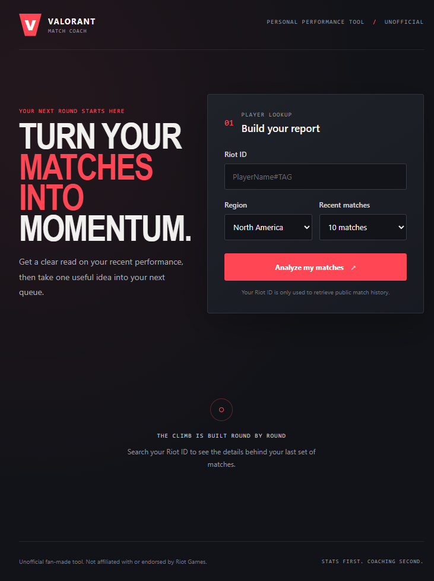

# Valorant AI Match Coach

A personal, non-commercial match dashboard that calculates performance stats in the backend and optionally asks Gemini to explain them. Match history is provided by the **unofficial Valorant API (HenrikDev)**. This project is not affiliated with or endorsed by Riot Games. It uses an unofficial API for personal, non-commercial purposes.

## Requirements

- Node.js 20 or newer
- A reachable MongoDB instance (the provided local Docker container or MongoDB Atlas)
- A HenrikDev API key for match history
- A Google Gemini API key and configured model for coaching (optional; the dashboard still shows stats without it)

## Local setup

1. Start this project's dedicated local MongoDB container. It uses host port `27018` and its own persistent volume, separate from any other MongoDB container:

   ```sh
   docker run -d --name valorant-coach-mongodb --restart unless-stopped -p 127.0.0.1:27018:27017 -v valorant-coach-mongodb-data:/data/db mongo:7
   ```

   Start it later with `docker start valorant-coach-mongodb`. The project `.env` is already configured for `mongodb://127.0.0.1:27018/valorant-coach`.
2. If setting up from scratch, copy `.env.example` to `.env`.
3. Set these values in `.env`:

   ```dotenv
   MONGODB_URI=mongodb://127.0.0.1:27018/valorant-coach
   HENRIK_API_KEY=your-henrikdev-key
   GEMINI_API_KEY=your-gemini-key
   GEMINI_MODEL=your-enabled-gemini-model
   PORT=4000
   CLIENT_ORIGIN=http://localhost:5173
   ```

   `GEMINI_API_KEY` and `GEMINI_MODEL` can be left blank to disable coaching while still using the stats dashboard. Never commit `.env`.
4. Install dependencies and start the frontend and backend:

   ```sh
   npm install
   npm run dev
   ```
5. Open [http://localhost:5173](http://localhost:5173).

The backend listens on port 4000 by default. The frontend proxies `/api` requests to it during development.
For production, set `MONGODB_URI` to your MongoDB Atlas connection string in the backend deployment environment; the app does not require Docker in production.

## Production deployment

The frontend deploys to Vercel, the Express API deploys to Render, and MongoDB Atlas stores the cache. Deploy the frontend once to get its production origin, then deploy the API and update the frontend with the API's public URL.

### MongoDB Atlas

1. Create an Atlas cluster and a database user with a strong password.
2. In **Network Access**, allow the Render service's outbound IP addresses. Avoid `0.0.0.0/0` unless you knowingly accept allowing connections from every IP.
3. Copy the Atlas connection string. Replace its password placeholder with the database user's password and set the database name to `valorant-coach`.

### Vercel frontend

1. Import the repository into Vercel with the project root set to the repository root. The included `vercel.json` builds the client workspace and publishes `client/dist`.
2. Deploy once to establish the site's production origin (the API URL can be configured afterward).

### Render API

1. Create a Render **Blueprint** from this Git repository and use the included `render.yaml`, or create a Node web service from the repository root.
2. Set the service environment variables: `MONGODB_URI` (Atlas URI), `HENRIK_API_KEY`, and `CLIENT_ORIGIN` (the deployed Vercel site's exact origin, such as `https://your-app.vercel.app`). The Blueprint prompts for these values.
3. `GEMINI_API_KEY` is optional; add it in the Render service environment settings to enable coaching. `GEMINI_MODEL` defaults to `gemini-3.8-flash`, and can be changed in Render if needed.
4. Build command: `npm install && npm run build --workspace server`
5. Start command: `npm run start --workspace server`
6. Wait for `/api/health` to pass, then copy the service URL (for example, `https://your-service.onrender.com`).

### Connect Vercel to Render

Set Vercel's `VITE_API_BASE_URL` environment variable to the Render service URL, without a trailing slash (for example, `https://your-service.onrender.com`), then redeploy the frontend.

The frontend embeds `VITE_API_BASE_URL` at build time, so redeploy Vercel after changing it. Never put API keys or the Atlas URI in Vercel client-side environment variables.

## Environment variables

| Variable | Required | Purpose |
| --- | --- | --- |
| `MONGODB_URI` | Yes | MongoDB connection string |
| `HENRIK_API_KEY` | Yes | HenrikDev API authentication |
| `GEMINI_API_KEY` | No | Enables coaching feedback |
| `GEMINI_MODEL` | No | Gemini model name, supplied by environment |
| `PORT` | No | Backend port (default: `4000`) |
| `CLIENT_ORIGIN` | No | Deployed frontend origin allowed by CORS |
| `VITE_API_BASE_URL` | Production frontend | Render API base URL; do not include `/api` |

## Screenshot



## Disclaimer

This project is not affiliated with or endorsed by Riot Games. It uses an unofficial API for personal, non-commercial purposes.
